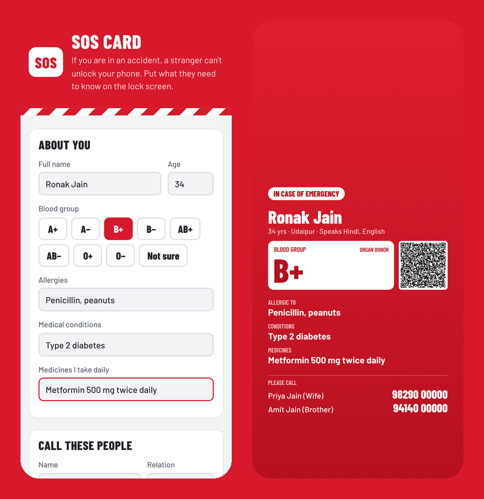

# SOS Card

**Make an emergency medical lock-screen wallpaper and wallet card: blood group, allergies, medicines, emergency contacts and a QR code.**

### ▶ Use it now: https://jainronakwork-jr.github.io/sos-card/

After an accident, the people helping you — a passer-by, an ambulance crew, a doctor — usually cannot unlock your phone. SOS Card puts the information that matters (blood group, allergies, conditions, daily medicines, who to call) on your lock screen, where anyone can see it, plus a printable wallet card.



## What it does

- Fill a short form; see a **live lock-screen preview** inside a phone frame, with the clock area kept clear.
- Download a full-resolution wallpaper sized for your phone (Android and iPhone sizes).
- Includes a **QR code with all your details as plain text** — any camera can read it, no internet or app needed.
- Printable credit-card-size wallet card (front and back) or download as an image.
- Three colour styles: Signal red, Night, White.
- Text automatically shrinks to fit, so long medicine lists still fit on the screen.
- Data saved only on your device. Works offline.

## Install it like an app

Open the link on your phone, then:
- **Android (Chrome):** menu ⋮ → *Add to Home screen* / *Install app*.
- **iPhone (Safari):** Share → *Add to Home Screen*.

After the first visit it works with no internet.

## Privacy

There is no server, no account, no analytics. Everything you type is stored only in your own browser on your own device. Clearing your browser data deletes it — use the backup option where available.

## Run it yourself

It is a plain static website — no build step, no dependencies.

```bash
git clone https://github.com/jainronakwork-jr/sos-card.git
cd sos-card
python3 -m http.server 8000
# open http://localhost:8000
```

Or host the folder on any static host (GitHub Pages, Netlify, Cloudflare Pages).

## Project structure

```
index.html            page
style.css             design
app.js                
vendor/qrcode.js      
sw.js                 offline support (service worker)
manifest.webmanifest  install-as-app settings
fonts/                self-hosted fonts (SIL Open Font License)
icons/, icon.svg      app icons
```

## Credits

QR codes are generated with [qrcode-generator](https://github.com/kazuhikoarase/qrcode-generator) by Kazuhiko Arase (MIT).

## License

MIT — free to use, share and improve. Fonts are from [Fontsource](https://fontsource.org) under the SIL Open Font License.
